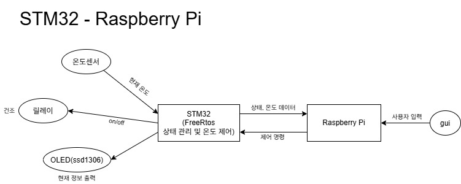
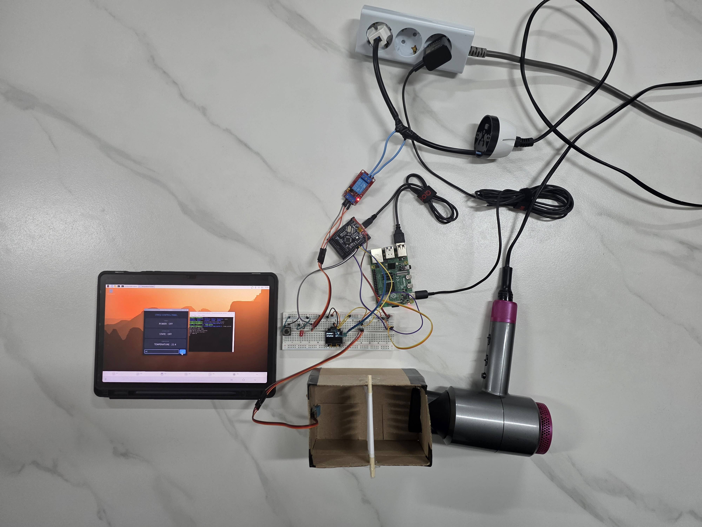

# Smart-Temperature-System

## 1. 프로젝트 소개

**온도조절을 통한 소형 양말 건조기**

---

## 2. 원인 및 해결 방안
 
### 원인
* 비 오는 날 활동으로 인한 양말 젖음
* 세탁 후 양말이 충분히 건조되지 않는 문제

### 해결 방안
* 헤어드라이기 자동 조절(릴레이)

---

## 3. 사용 부품

* STM32F103C8T6
* Raspberry Pi 4 
* DHT11 온도 센서
* SSD1306 OLED 디스플레이
* 릴레이 모듈
* LED
* 택트 스위치
* 헤어드라이기

---

## 4. 트러블 슈팅

* 온도센서 통신간 타이밍 오류 발생 -> FreeRtos 사용간 임계영역(critical)으로 타이밍 보장 및 tim로 delay 구현
* 힙 메모리 부족으로 task 생성 실패 -> STM32CubeMX의 메모리 설정을 조정

---

## 5. 결과

시연 영상 : https://youtu.be/RZiizqCIeg0

* UART 기반 STM32–Raspberry Pi 통신 구현
* Linux C, FIFO를 활용한 프로세스 간 통신 및 GTK GUI 연동
* FreeRTOS 기반 태스크 분리 및 시스템 상태 관리

---