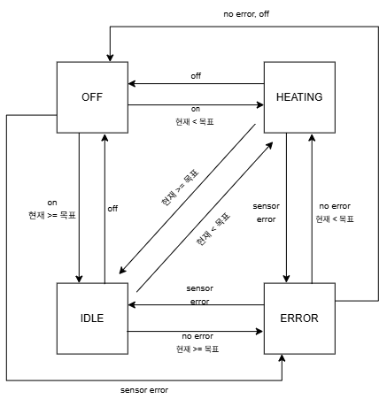
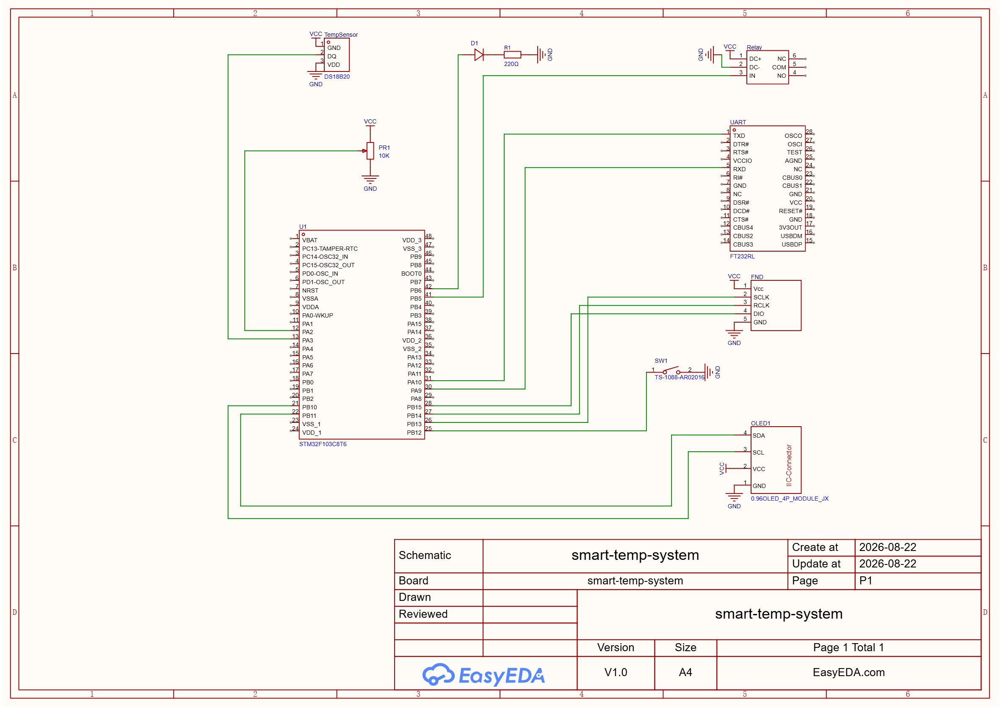

# Stm32-Smart-Temperature-System

## 1. 프로젝트 소개

STM32의 동작 원리와 Clock 설정, 다양한 주변장치 제어를 학습하고 이를 활용한 임베디드 시스템 설계 능력을 향상시키기 위해 프로젝트를 진행하였다. 또한, 학습한 기술을 바탕으로 실생활에서 활용 가능한 소형 양말 건조기를 구현하는 것을 목표로 하였다.

---

## 2. 기술 및 구현 기능

| 사용 기술 | 구현 기능 |
|------|------|
| **GPIO** | 버튼 입력 및 릴레이 제어 |
| **One-Wire** | DS18B20 온도 센서와 통신하여 현재 온도 측정 |
| **ADC** | 가변저항을 이용한 목표 온도 설정 |
| **SPI** | 74HC595를 이용한 FND 출력 |
| **I2C** | SSD1306 OLED 화면 출력 |
| **UART** | PC 시리얼 모니터링 |
| **State Machine** | 시스템 상태(OFF, IDLE, HEATING, ERROR) 관리 |
| **FreeRTOS** | 기능별 Task 분리 및 멀티태스킹 구현 |

---

## 3. 시스템 구성

### 소프트웨어 구조

* FreeRTOS 기반으로 LED, FND, Temp, State , UART, OLED의 총 6개의 Task를 독립적으로 실행하도록 설계
* 각 Task는 주기적으로 동작하며, Mutex를 이용해 공유 자원(System_Data) 에 안전하게 접근하여 현재 온도, 목표 온도, 시스템 상태를 공유
* FND Task는 ADC를 통해 목표 온도를 입력받아 FND에 표시하고, 해당 값을 공유 자원에 저장
* Temp Task는 현재 온도를 측정하여 공유 자원에 저장
* State Task는 목표 온도와 현재 온도를 비교 및 버튼 플래그를 확인하여 상태(State)를 전이하고 릴레이 제어
* OLED, UART Task는 동일한 공유 데이터를 참조하여 현재 상태와 온도 정보를 각각 화면과 시리얼 모니터에 출력

### 상태전이도

---

## 4. 하드웨어 구성

### 사용 부품

* stm32f103c8t6
* DS18B20 온도 센서
* SSD1306 OLED 디스플레이
* 릴레이 모듈
* LED
* 택트 스위치
* 4-Digit FND (74HC595)
* 가변저항
* 드라이기(건조 장치)
* 멀티탭 (릴레이와 드라이기 연결용)

### 회로도

---

## 5. 시스템 사진

시연 영상 : 

---

# 5. 트러블

* **One-Wire 통신 구현**

  * 예제 코드와 동일한 타이밍으로 구현했음에도 DS18B20과 정상적으로 통신되지 않는 문제가 발생하였다.
  * GPIO를 Input/Output으로 전환하는 과정에서 발생하는 시간 오차를 고려하여 타이밍을 조정함으로써 정상적으로 통신하도록 개선하였다.

* **OLED 동작 중 멈춤 현상**

  * 일정 시간 동작 후 OLED가 갱신되지 않고 멈추는 현상이 발생하였다.
  * HAL Driver의 반환값을 확인하여 비정상 상태가 감지되면 OLED를 초기화하고 다시 시작하도록 구현하여 문제를 해결하였다.

* **디버깅 오류 및 Task 스택 부족**

  * 디버깅 오류와 FreeRTOS Task의 스택 부족으로 인해 프로그램이 비정상적으로 동작하는 문제가 발생하였다.
  * STM32CubeMX의 설정을 수정하고 Task 스택 크기를 조정하여 안정적으로 동작하도록 개선하였다.

* **릴레이의 잦은 ON/OFF 반복**

  * 현재 온도가 목표 온도 경계 부근에서 변할 경우 `HEATING ↔ IDLE` 상태가 반복 전이되며 릴레이가 빠르게 ON/OFF되는 문제가 발생하였다.
  * `HEATING → IDLE`과 `IDLE → HEATING`의 기준 온도를 다르게 설정하는 **히스테리시스(Hysteresis)** 기법을 적용하여 불필요한 상태 전이를 방지하였다.

---

# 6. 느낀 점

* GPIO, UART, SPI, I2C 등 임베디드 시스템의 기본 주변장치를 직접 구현하고 활용하며 동작 원리를 이해할 수 있었다.
* 비트뱅잉(Bit-Banging) 방식으로 One-Wire 통신을 직접 구현하면서 타이밍 제어와 비트 단위 데이터 처리에 대한 이해도를 높일 수 있었다.
* FreeRTOS는 Task가 정상적으로 동작하는 것뿐만 아니라, Stack 사용량을 지속적으로 확인하고 적절한 크기로 관리하는 것이 시스템의 안정성에 매우 중요하다는 것을 배웠다.
* 프로젝트 규모가 커질수록 코드의 유지보수성이 중요하다는 것을 느꼈으며, 기능별 소스 파일과 헤더 파일을 체계적으로 분리하는 설계의 중요성을 경험하였다.