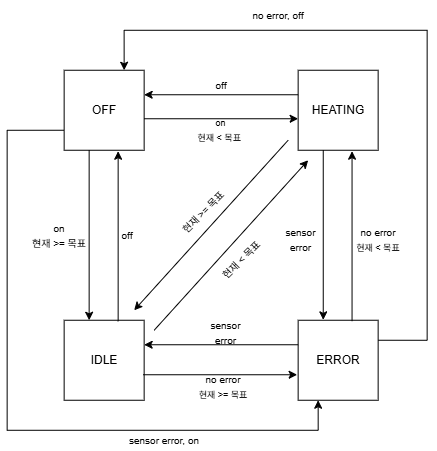
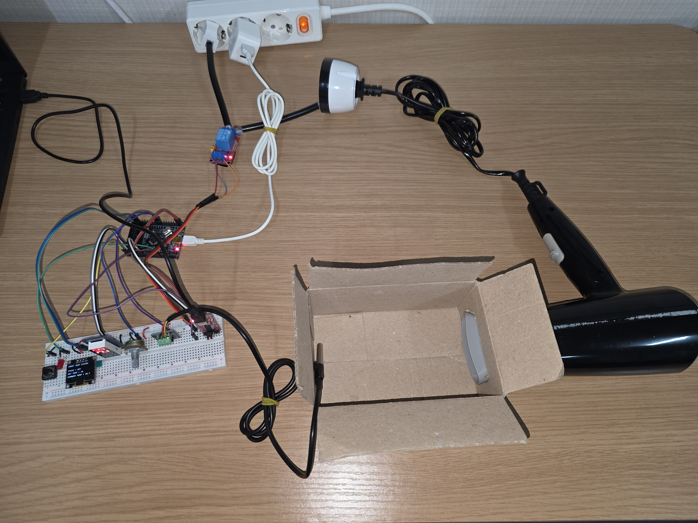

# Stm32

## 1. 기술 및 구현 기능

| 사용 기술 | 구현 기능 |
|------|------|
| **GPIO** | 버튼 입력 및 릴레이 제어 |
| **One-Wire** | DS18B20 온도 센서와 통신하여 현재 온도 측정 |
| **ADC** | 가변저항을 이용한 목표 온도 설정 |
| **SPI** | 74HC595를 이용한 FND 출력 |
| **I2C** | SSD1306 OLED 화면 출력 |
| **UART** | PC 시리얼 모니터링 |
| **State Machine** | 시스템 상태(OFF, IDLE, HEATING, ERROR) 관리 |
| **FreeRTOS** | 기능별 Task 분리 및 멀티태스킹 구현 |

---
## 2. 하드웨어 구성

### 사용 부품

* stm32f103c8t6
* DS18B20 온도 센서
* SSD1306 OLED 디스플레이
* 릴레이 모듈
* LED
* 택트 스위치
* 4-Digit FND (74HC595)
* 가변저항
* 드라이기(건조 장치)
* 멀티탭 (릴레이와 드라이기 연결용)

### 회로도

---

## 3. 상태전이도

---

## 4. 결과

시연 영상 : https://youtu.be/ANTitgE3GZw

---